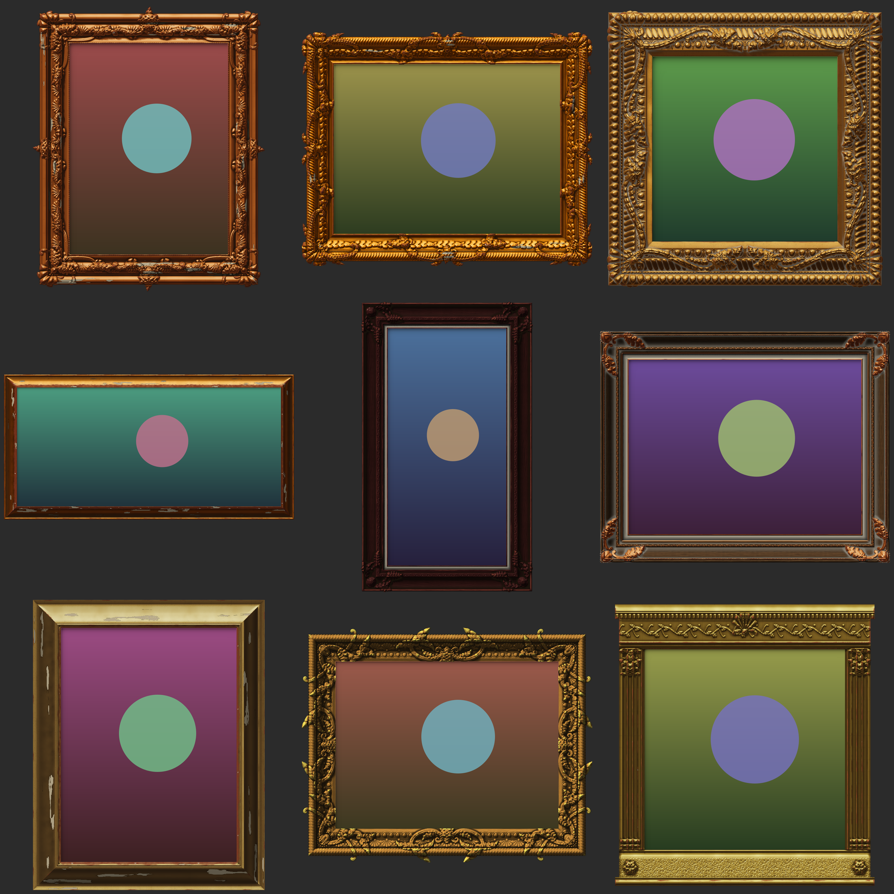
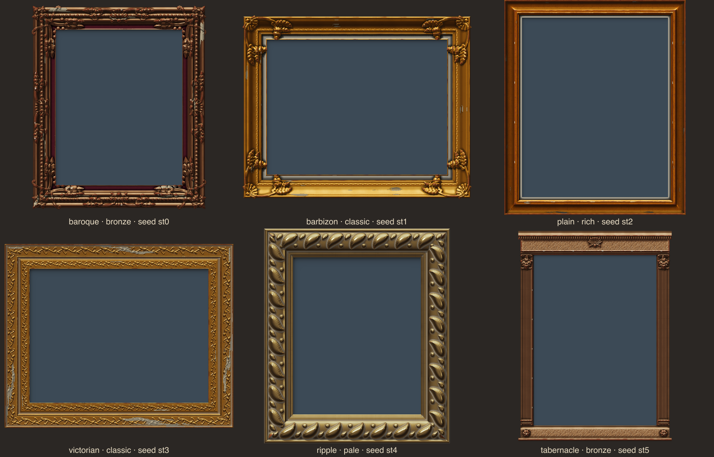
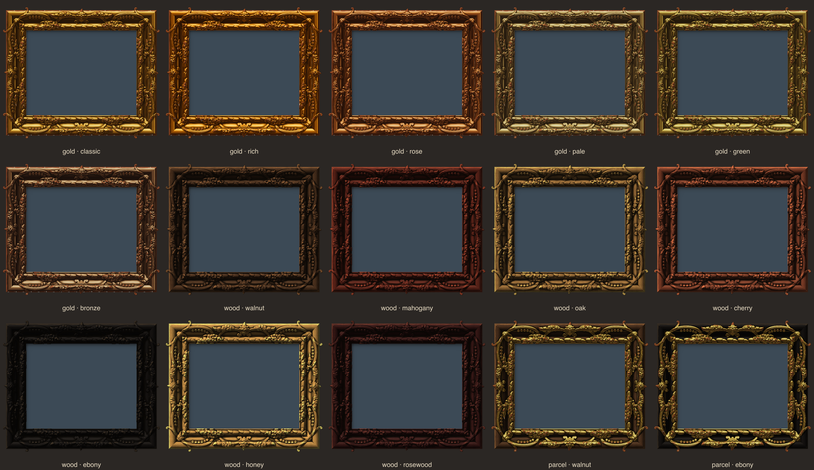
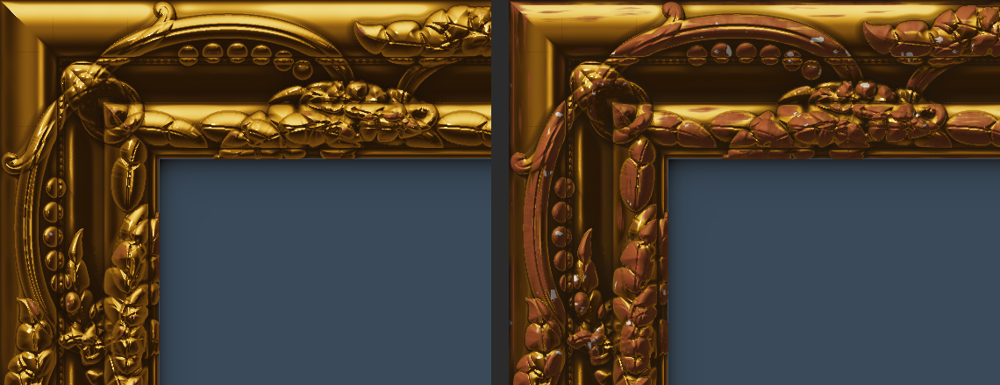

# gilt-frame

Procedurally generated **ornate Baroque / Rococo carved picture frames** (gilt, wood or parcel-gilt) for any image, any size, any ratio, rendered per pixel to look like photographed gilding, wear included.

Designs aren't picked from a pool. Each seed picks a **style**, then drives continuous parameters within it:
- **Style:** Baroque / Rococo, Barbizon (Louis XV revival), plain moulding, Victorian compo, auricular ripple, or architectural tabernacle.
- **Moulding profile:** torus, cove, ogee, scotia, bead, sanded frieze, and a velvet or linen liner.
- **Carved runs:** acanthus, water-leaf, gadroon, egg-and-dart, rinceau, rope, pearls, bead-and-reel and shells.
- **Cartouches:** volute curvature, leaf lobing and curl, shell ribs and asymmetry, and their layout.
- **Finish:** gilt, carved wood or parcel-gilt; the gold alloy or timber; burnish; and the type and amount of wear.

Pass a seed string to get the same frame back at any image size.



One frame per style:



| style | share of seeds | what it is |
|---|---|---|
| `baroque` | 40% | layered carved runs, corner and centre cartouches with volutes, acanthus and shells |
| `barbizon` | 16% | a big swept ogee or cove, small corner cartouches with leaf sprays, a narrow carved run, often a linen liner and gilt slip |
| `plain` | 14% | a single cushion, scoop or ogee moulding with no carving; wear (flaking, craquelure) does the talking |
| `victorian` | 12% | wide flat friezes packed with low-relief compo foliage between pearl or rope borders |
| `ripple` | 9% | one broad cove carved with bold auricular lobes, often with pale gesso wash in the recesses |
| `tabernacle` | 9% | architectural: dentil cornice and frieze on top, fluted pilasters with capitals, plinth with rosette blocks; butt joints, taller top and bottom |

One seed in every finish and palette:



`wear: 0` vs `wear: 0.75`, same seed:



## Install

```bash
npm i gilt-frame          # zero-dependency core (Node, browsers, workers, edge)
npm i sharp               # optional: framed PNG/JPEG/WebP/AVIF in Node
```

## Use

### Node

```js
import { frameImageToFile, frameImage } from 'gilt-frame/node';

const { seed } = await frameImageToFile('photo.jpg', 'framed.png');            // random frame
await frameImageToFile('other.jpg', 'same-frame.webp', { seed });               // same design, other picture
const { buffer } = await frameImage(buf, { seed: 'louis-xiv', wear: 0.6, format: 'jpeg', quality: 90 });
```

Rendering is spread over CPU cores (worker threads on shared memory). The output is bit-identical to the single-threaded render, so seeds stay reproducible.

### CLI

```bash
npx gilt-frame photo.jpg framed.png --seed louis-xiv --wear 0.4
npx gilt-frame photo.jpg framed.png --finish parcel --palette walnut
npx gilt-frame photo.jpg framed.png --style tabernacle
```

### React

```jsx
import { GiltFrame } from 'gilt-frame/react';

<GiltFrame src="/painting.jpg" seed="rocaille-7" wear={0.3} onSeed={(s) => console.log(s)} />
<GiltFrame src="/portrait.jpg" finish="wood" palette="mahogany" />
<GiltFrame src="/landscape.jpg" frameStyle="barbizon" />
```

The picture is a normal ``. The frame is a `<canvas>` rendered in a Web Worker, so the main thread stays free. It is responsive, and layout is known before rendering finishes. Pass `width`/`height` (the image's intrinsic size) to skip measuring the image.

### Anywhere (raw pixels)

```js
import { renderFrame } from 'gilt-frame';

const f = renderFrame({ width: 1200, height: 800, seed: 'versailles' });
ctx.putImageData(new ImageData(f.data, f.width, f.height), 0, 0);
// the picture goes at (f.imageX, f.imageY) × f.scale; the opening holds only the frame's cast shadow
```

`examples/browser.html` is a live demo, and `examples/perf.js` reproduces the numbers below. Run `node examples/serve.js` and open http://localhost:5178/.

## Recreating a frame from its class

Every frame's root element carries a **settings class** with everything needed to recreate it. That's the wrapper `<div>` in React; the CLI prints it after each run, and `renderFrame` / `frameLayout` return it as `className`:

```
gilt-frame gilt-frame-e8wffc1rds-w0-ripple-gold-classic
                     └ seed   └wear% └style └finish └palette
```

| part | meaning |
|---|---|
| seed | the seed. Characters other than letters and digits (dashes included) are escaped as `_<hex>_`, e.g. `my seed-1` becomes `my_20_seed_2d_1` |
| `w30` | wear in percent; decimals use `p`, e.g. `w33p3` = 33.3% |
| style | `baroque` `barbizon` `plain` `victorian` `ripple` `tabernacle` |
| finish | `gold` `wood` `parcel` |
| palette | gold tone or wood; parcel-gilt shows both as `wood_gold`, e.g. `walnut_rich` |
| `t…` / `o…` | thickness / overhang, only present when set explicitly (`t0p15` = 0.15, `t40` = 40 px) |

Inspect a frame you like in devtools, copy the class, and turn it back into options:

```js
import { parseFrameClass, renderFrame } from 'gilt-frame';

const opts = parseFrameClass(document.querySelector('.gilt-frame').classList);
// { seed: 'e8wffc1rds', wear: 0, style: 'ripple', finish: 'gold', palette: 'classic' }
renderFrame({ width: 1200, height: 800, ...opts }); // same frame
```

```bash
npx gilt-frame photo.jpg framed.png --class gilt-frame-e8wffc1rds-w0-ripple-gold-classic
```

The seed's own default wear is a whole percent, so a class always reproduces its frame exactly. `seedFromClass(classList)` still returns just the seed.

## Options

| option | default | |
|---|---|---|
| `width`, `height` | required | picture size in px |
| `seed` | random | any string; the same seed gives the same design at **every** size and ratio |
| `wear` | from seed (0.15–0.45) | 0 = fresh gilding … 1 = rubbed through to the red bole, chipped to the gesso, grime in the recesses |
| `style` | from seed | `baroque` `barbizon` `plain` `victorian` `ripple` `tabernacle` (in React the prop is `frameStyle`, since `style` is the CSS prop) |
| `finish` | from seed (gold 62%, wood 24%, parcel 14%) | `gold`, `wood`, or `parcel` (carved wood with gilded carving and sight edge) |
| `palette` | from seed | gold: `classic` `rich` `rose` `pale` `green` `bronze`; wood: `walnut` `mahogany` `oak` `cherry` `ebony` `honey` `rosewood`. Each seed adds a small tint jitter. A wood name implies `wood` when `finish` isn't set |
| `thickness` | from seed (15–25% of short side) | moulding width; px if > 1, else a fraction of the short side |
| `overhang` | from seed | room for crests outside the moulding, as a fraction of thickness (`0` = flush rectangle) |
| `maxThickness` | 420 (React: 260) | detail budget: the moulding renders at most this wide, then upscales (lanczos) |
| `format`, `quality`, `background`, `threads` | `png` | Node output encoding and thread count; JPEG is flattened onto `background` (white by default) |

## How it looks real

1. **Height field, not vector art.** The moulding cross-section is a real height profile with fillet steps, mitred per pixel. Every carved element (leaf, volute, shell rib, pearl) is scan-filled, turned into a rounded dome by an exact Euclidean distance transform, and stacked on what's beneath it. Midribs, veins and scroll channels are carved in the same way.
2. **Lighting.** Normals; ray-marched cast shadows; cavity occlusion; and a metallic studio-reflection model with burnished highlights on proud surfaces and matte gold in recesses and sanded friezes. Velvet or linen liners are lit as fabric.
3. **Wood is its own material.** Annual rings and pore streaks run along each side and change direction at the mitres, as in real joinery. The wood takes diffuse light with a varnish highlight, and wear exposes paler bare wood rather than bole.
4. **Different joinery per style.** Ring styles are mitred per pixel. Tabernacle frames use butt joints: the entablature and plinth run the full width, their cornice and base mouldings project past the sides, and fine seams mark where members meet. The picture's position and the output size account for the taller top and bottom (`thicknessTop`, `thicknessBottom`, `imageY`).
5. **Wear driven by exposure.** Gilding is rubbed through to red bole where hands and dusting cloths reach: the proudest carving, sharp ridges and outer edges. The abrasion is streaked along the moulding. Gesso chips show on the worst spots, grime (or, on limed frames, pale gesso wash) settles in crevices, plain gilt loses whole patches of leaf in streaks along edges and the lower rail, craquelure crazes the flats, gold-leaf sheets vary slightly in tone with faint seams, and mitre joints open up.

## Performance

Measured on an Apple M-series machine (10 performance cores) with `node --expose-gc examples/perf.js`. Median single-thread `renderFrame` time:

| style | 800×600 | 1920×1080 | 4000×3000 |
|---|---|---|---|
| baroque | 154 ms | 419 ms | 2.1 s |
| barbizon | 117 ms | 410 ms | 1.7 s |
| plain | 71 ms | 263 ms | 1.7 s |
| victorian | 124 ms | 458 ms | 1.7 s |
| ripple | 139 ms | 522 ms | 1.5 s |
| tabernacle | 85 ms | 318 ms | 1.1 s |

Full Node pipeline (`frameImage` to JPEG, threaded): 117 ms at 800×600, 183 ms at 1920×1080, 632 ms at 4000×3000.

Working memory per render: about 8 MB at 800×600, 31 MB at 1920×1080, 88 MB at 4000×3000. Most of that is the RGBA output itself.

The package is 40 KB with zero runtime dependencies in the core, and it imports in about 5 ms.

What keeps it fast and light:
- **Build once, stamp many.** Each band motif is one periodic relief tile, sampled with wrap-around along all four sides. Corner cartouches are built once and mirrored into four corners; side cartouches are rotated copies. Tiles are supersampled 2× only when they're small enough to need it.
- **Only the frame is stored.** Rows that cross the picture opening keep just the frame plus the margin where its shadow falls; the opening's interior is never allocated or visited. Alpha, coverage, material and side live in bytes. The opening's shadow is analytic, so no rays are traced there.
- **JIT-friendly inner loops.** Shadow-ray indices are coerced to integers (`Math.round` can return `-0`, which made V8 discard the optimised loop over 200 times per render), and every ray picks its row table once.
- **Detail budget.** A 6000 px photo doesn't need a 1200 px-wide carving rendered at full size. The moulding renders at up to `maxThickness` px, then upscales with lanczos.
- **Threads, not a port.** Profiling showed the remaining cost is ordinary per-pixel lighting maths. In Node the row phases run on a worker pool over SharedArrayBuffers, with an atomic counter for load balancing: about 4× faster, with the same bytes out. Browsers render in a Web Worker. One readable JS codebase runs everywhere, with no native or WASM build step.

## Production notes

- **Input safety.** Every option is validated with no silent coercion: width and height must be finite numbers from 1 to 100,000; `wear` and `overhang` 0–1; `maxThickness` 16–4000; `seed` a string or number. A render also refuses a canvas over `maxPixels` (default 40 MP, about 440 MB of working memory) before allocating anything, and the Node pipeline refuses outputs over `maxOutputPixels` (default 268 MP). Errors are `TypeError` / `RangeError` with a message saying what to change. Sizes taken from uploads or query strings can't exhaust memory.
- **No side effects.** The core does no network or file access and no `eval`. The seed only reaches the DOM through the settings class, which escapes everything outside `[A-Za-z0-9]`, and frames are drawn to a canvas, so there's no HTML injection path. Untrusted image files are decoded by `sharp` (libvips) with its default limits.
- **Concurrency.** In Node, any number of `frameImage` / `renderFrameParallel` calls can run at once. They share one worker pool, replies are routed by job id, and a crashed worker fails only its own jobs and is replaced. Idle workers never keep the process alive; `closePool()` shuts them down explicitly.
- **React failures.** Invalid options or a failed render call `onError` (default `console.error`) and show the bare picture rather than throwing. If the worker file can't be loaded by your bundler, rendering falls back to the main thread.
- **Determinism across engines.** The same seed always gives the same design. Pixel values can differ by a level or two between JavaScript engines (V8, JavaScriptCore, SpiderMonkey), because their `Math.exp`/`pow`/`sin` round differently. Within one engine, output is byte-identical, threaded or not.
- **Tested.** On every push, CI runs the suite on Node 18, 20 and 22 (Linux and macOS): determinism, every style and finish, untrusted-input rejection, threaded vs single-threaded equality, and concurrent renders sharing the pool.

## Determinism

Each subsystem (proportions, colour, profile, bands, corner, centre, wear, noise) draws from its own forked PRNG stream (cyrb128 hash, then sfc32). A seed's design never depends on image dimensions; only tiling, fitting and detail scale adapt to the size. Rendering has no per-thread randomness.
